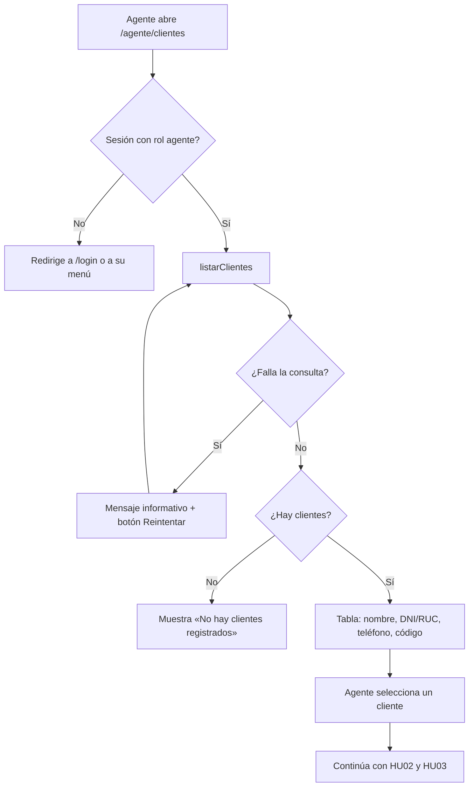
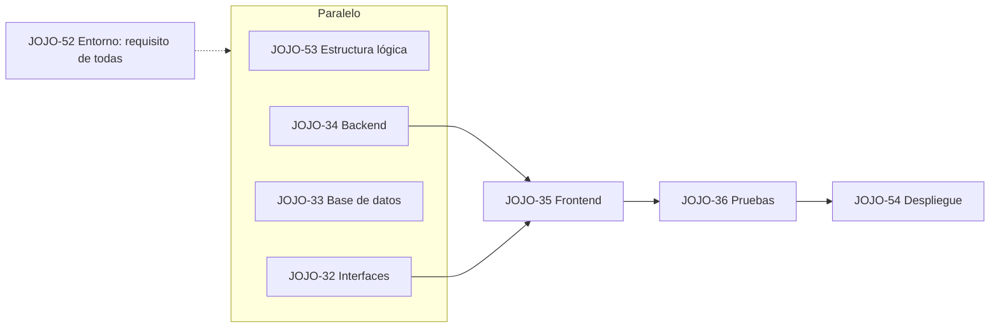

# HU01. Listar clientes · Estructura lógica (JOJO-53)

## Objetivo y alcance

HU01 permite al agente del call center ver la lista de clientes registrados y elegir al cliente que necesita atención por una avería.

- **Historia:** como agente del call center, quiero visualizar la lista de clientes registrados en el sistema, para identificar y seleccionar al cliente que necesita atención por una avería.
- **Actor y ruta:** agente de call center (rol agente) · `/agente/clientes`.
- **Ubicación en Jira:** historia JOJO-8 (1 punto), dentro de la épica «Atención de fallas simples» (JOJO-1), Sprint 1.
- **Dentro del alcance:** listar clientes, mostrar 4 datos por cliente, seleccionar un cliente, mensaje de lista vacía y mensaje de error con reintento.
- **Fuera del alcance:** buscar o filtrar clientes y ver su ficha e historial (HU02), registrar la avería (HU03). En HU01 los clientes no se crean ni se editan.

## Flujo general

Flujo de HU01 con 3 decisiones: si la consulta falla el agente reintenta, si no hay clientes ve el mensaje, y si los hay elige uno y continúa con HU02 y HU03.

## Criterios de aceptación y capa que los cumple

Los 7 criterios de JOJO-8 se reparten entre el backend (datos y reglas) y el frontend (pantalla).

| # | Criterio de aceptación | Backend (JOJO-34) | Frontend (JOJO-35) |
|---|---|---|---|
| 1 | Se muestra la lista de clientes registrados | Consulta la tabla `clientes` | Tabla con los registros |
| 2 | Cada registro muestra como mínimo nombre completo, DNI/RUC, teléfono y código de cliente | Devuelve esos 4 campos | Una columna por campo |
| 3 | El agente puede seleccionar un cliente para iniciar su atención | Entrega el `id` de cada cliente | Acción para seleccionar una fila |
| 4 | Al seleccionar, se accede a su información y sigue el proceso de averías | Nada adicional; la ficha la sirve HU02 | Lleva al flujo de HU02 y HU03 con el `id` |
| 5 | Sin clientes: «No hay clientes registrados» | `vacio: true` y el mensaje | Muestra el mensaje |
| 6 | La lista es de solo lectura | Solo `select`; no inserta, edita ni borra | Sin formularios ni botones de edición |
| 7 | Si falla la carga: mensaje informativo y reintentar | `ok: false` y `reintentar: true` | Muestra el mensaje y el botón Reintentar |

## Datos y seguridad

HU01 lee una sola tabla, `public.clientes` (Supabase), que ya está creada con datos de prueba y no se modifica.

| Campo en BD | Se muestra como | Uso |
|---|---|---|
| `nombre_completo` | Nombre completo | Columna de la lista; orden ascendente |
| `documento` | DNI/RUC | Columna de la lista |
| `telefono` | Teléfono | Columna de la lista |
| `codigo` | Código de cliente | Columna de la lista (formato CLI-00001) |
| `id` | No se muestra | Identifica al cliente seleccionado |

- **Acceso:** solo el rol agente. Si no hay sesión o el rol no coincide, la ruta redirige a `/login` o al menú del rol.
- **Seguridad en base de datos:** la política `clientes_ver` (RLS) permite `select` al personal; la aplicación no tiene política de inserción ni edición sobre `clientes`.
- **Solo lectura:** el backend de HU01 solo ejecuta consultas `select`.

## Capas y subtareas

HU01 se reparte en 8 subtareas (20 h en total); su estado se sigue en Jira. Cada una produce un entregable que la siguiente usa.

| Subtarea | Tipo · horas | Responsable | Entregable |
|---|---|---|---|
| JOJO-52 Preparar entorno de desarrollo | Configuración · 4 h | Sneider Araneda | Repositorio Next.js + Supabase con login por rol |
| JOJO-53 Definir estructura lógica | Análisis y diseño · 2 h | Javier Arturo Lopez Marchan | Este documento |
| JOJO-32 Crear interfaces | Prototipado · 2 h | Luis Eduardo Cieza Llanos | Prototipo de la pantalla de lista de clientes |
| JOJO-33 Crear base de datos | Codificación · 2 h | Jhosep Amaro Fabricio Narvaez Salas | Revisión en Supabase de que `clientes` cumple los criterios |
| JOJO-34 Programar backend | Codificación · 4 h | Javier Arturo Lopez Marchan | `listarClientes()` en `src/app/agente/clientes/actions.js` |
| JOJO-35 Programar frontend | Codificación · 3 h | Josep Karei Pereda Flores | Pantalla en `src/app/agente/clientes/page.js` (reemplaza `<Pendiente />`) |
| JOJO-36 Pruebas y depuración | Test · 2 h | Sneider Araneda | Casos de prueba de este documento ejecutados y errores corregidos |
| JOJO-54 Desplegar en la web | Configuración · 1 h | Jhosep Amaro Fabricio Narvaez Salas | HU01 publicada en Vercel |

## Contrato del backend

El frontend llama a `listarClientes()` (Server Action, sin parámetros) y recibe siempre un objeto con `ok`.

| Caso | Respuesta | Qué hace el frontend |
|---|---|---|
| Hay clientes | `{ ok: true, vacio: false, clientes: [{ id, codigo, nombre_completo, documento, telefono }] }` | Dibuja la tabla |
| No hay clientes | `{ ok: true, vacio: true, clientes: [], mensaje: "No hay clientes registrados" }` | Muestra el mensaje |
| Falla la consulta | `{ ok: false, error: "No se pudo cargar la lista de clientes. Intenta nuevamente.", reintentar: true }` | Muestra el error y el botón Reintentar, que vuelve a llamar la función |

Los clientes llegan ordenados por `nombre_completo`. La función exige sesión con rol agente; con otro rol redirige antes de consultar.

## Casos de prueba

Son 8 casos, uno o más por criterio de aceptación; JOJO-36 los ejecuta con la cuenta `agente@demo.com`.

| Caso | Criterio | Pasos | Resultado esperado |
|---|---|---|---|
| CP-01 | 1, 2 | Entrar como agente y abrir `/agente/clientes` | Aparece la lista con nombre completo, DNI/RUC, teléfono y código de cada cliente |
| CP-02 | 1 | Revisar el orden de la lista | Los clientes salen ordenados por nombre |
| CP-03 | 3, 4 | Seleccionar un cliente de la lista | Se abre su información y continúa el proceso de averías con ese cliente |
| CP-04 | 5 | Con una base de datos de prueba propia y sin registros en `clientes` (nunca vaciar la compartida), abrir la lista | Aparece «No hay clientes registrados» |
| CP-05 | 6 | Buscar en la pantalla campos o botones para editar o borrar | No existen; no se puede modificar ningún dato |
| CP-06 | 7 | Simular un fallo de carga cambiando temporalmente en tu copia el nombre de la tabla de la consulta (sin subir ese cambio) | Aparece un mensaje informativo y el botón Reintentar |
| CP-07 | 7 | Pulsar Reintentar con el nombre de la tabla ya corregido | La lista se carga sin recargar la página a mano |
| CP-08 | Acceso | Abrir `/agente/clientes` con `gerente@demo.com` y sin sesión | Con otro rol redirige a su menú; sin sesión redirige a `/login` |

## Dependencias y orden

Orden de las subtareas de HU01: 4 en paralelo y 3 en cadena. El frontend espera al backend y al prototipo, las pruebas esperan al frontend y el despliegue va al final; JOJO-52 (entorno) es requisito de todas.
