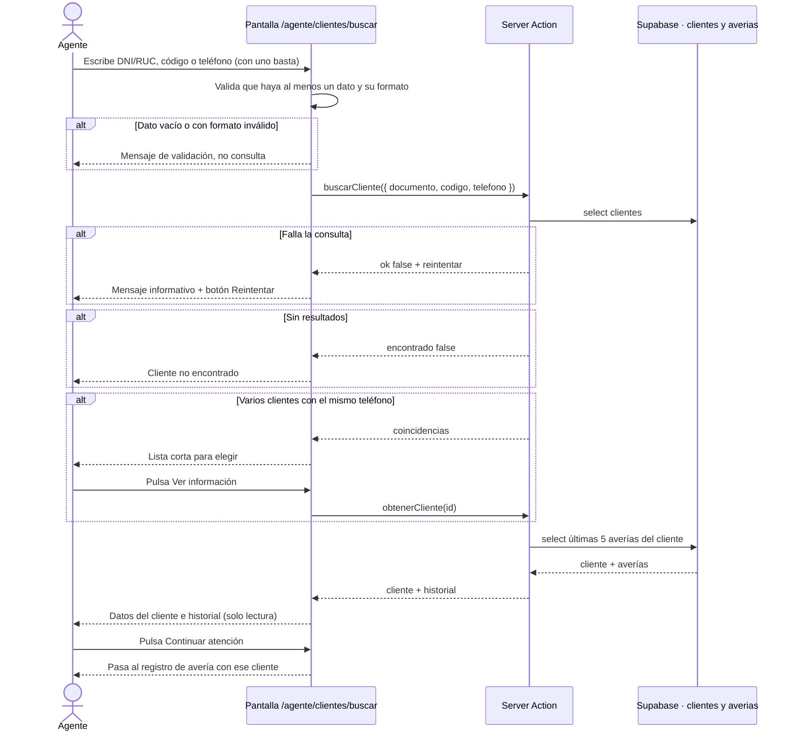

# HU02. Buscar información del cliente · Estructura lógica (JOJO-55)

## Objetivo y alcance

HU02 permite al agente del call center buscar a un cliente por DNI/RUC, código o teléfono, ver sus datos y el historial de sus últimas 5 averías, y continuar con la atención.

- **Historia:** como agente del call center, quiero buscar al cliente por sus datos de identificación para ver su información y así iniciar la atención.
- **Actor y ruta:** agente de call center (rol agente) · `/agente/clientes/buscar`.
- **Ubicación en Jira:** historia JOJO-9 (2 puntos), Sprint 1.
- **Dentro del alcance:** buscar con uno o más datos, mostrar nombre, documento, teléfono, correo y dirección, mostrar las últimas 5 averías, avisar «Cliente no encontrado» y ofrecer continuar la atención.
- **Fuera del alcance:** registrar, editar o borrar clientes (HU02 es solo lectura), y buscar por nombre.

## Reglas de negocio

Salen de los 5 criterios de aceptación de la historia JOJO-9 (campo "Criterios de Aceptación" en Jira) y del esquema de `public.clientes` y `public.averias`.

1. Se busca por **DNI/RUC, código de cliente o teléfono**. Con **uno basta**. Si se escriben varios, el cliente debe cumplir todos.
2. Se muestran **nombre completo, documento, teléfono, correo y dirección**. Si no hay correo se muestra «—».
3. Se muestra el **historial de las últimas 5 averías** del cliente (código, fecha, tipo y estado), de la más reciente a la más antigua. Si no tiene averías se muestra «Este cliente no tiene averías registradas».
4. Los datos son **solo de lectura**: HU02 no registra ni edita clientes.
5. Si no hay resultados se muestra **«Cliente no encontrado»**.
6. Formatos: DNI de 8 dígitos o RUC de 11, teléfono de 9 dígitos, código con el formato `CLI-00001`. Con formato inválido no se consulta.
7. El teléfono no es único en la tabla. Si varios clientes lo comparten, se muestra una lista corta para elegir.

## Flujo general

## Criterios de aceptación y capa que los cumple

Criterios tal como están en Jira (JOJO-9).

| # | Criterio de Jira | Backend (JOJO-39) | Frontend (JOJO-40) |
|---|---|---|---|
| 1 | Busca por DNI/RUC, código o teléfono (con uno basta) | `buscarCliente` acepta los tres datos, exige al menos uno y filtra por los que lleguen | Tres campos; basta llenar uno |
| 2 | Muestra nombre, documento, teléfono, correo y dirección | Devuelve esos campos del cliente | Tarjeta con los cinco datos |
| 3 | Historial de las últimas 5 averías (código, fecha, tipo, estado) | Consulta ordenada por `fecha_registro` descendente con límite 5 | Tabla con las 4 columnas |
| 4 | Solo lectura: no registra ni edita clientes | Solo `select`; no hay `insert`, `update` ni `delete` | Sin botones de editar ni borrar |
| 5 | Sin resultados: «Cliente no encontrado» | `encontrado: false` con ese mensaje | Muestra el mensaje |

Si falla la consulta, el backend devuelve `ok: false` y `reintentar: true`, y el frontend muestra el mensaje con el botón Reintentar.

## Datos y seguridad

HU02 solo lee `public.clientes`, `public.averias` y `public.tipos_averia`. Las tablas ya existen; no se modifican.

| Dato | Tabla y campo |
|---|---|
| Nombre, documento, teléfono, correo, dirección, código | `clientes` |
| Código, fecha, estado de cada avería | `averias.codigo`, `fecha_registro`, `estado` |
| Tipo de avería | `tipos_averia.nombre` |

- **Acceso:** solo el rol agente. Sin sesión redirige a `/login`; con otro rol, a su menú.
- **Base de datos (RLS):** `clientes_ver` y `averias_ver` permiten leer al personal. HU02 no necesita políticas nuevas.
- **Índices:** `documento` y `codigo` ya son únicos. Un índice sobre `telefono` es opcional.

## Contrato del backend

Archivo: `src/app/agente/clientes/buscar/actions.js`. Todas devuelven `{ ok: true, ... }` o `{ ok: false, error: "mensaje" }`.

| Función | Entrada | Respuesta |
|---|---|---|
| `buscarCliente(datos)` | `{ documento, codigo, telefono }` (basta uno) | Un cliente: `{ ok: true, encontrado: true, cliente, averias }` |
| `buscarCliente(datos)` | Teléfono compartido | `{ ok: true, encontrado: true, varios: true, coincidencias: [...] }` |
| `buscarCliente(datos)` | Sin resultados | `{ ok: true, encontrado: false, mensaje: "Cliente no encontrado" }` |
| `obtenerCliente(clienteId)` | `id` de una coincidencia | Igual que un cliente |
| Falla la consulta | — | `{ ok: false, error: "No se pudo buscar al cliente. Intenta nuevamente.", reintentar: true }` |

`cliente` trae `id`, `codigo`, `nombre_completo`, `documento`, `telefono`, `correo` y `direccion`. Cada elemento de `averias` (máximo 5) trae `id`, `codigo`, `fecha_registro`, `estado` y `tipo.nombre`.

Errores de validación (mensajes en español para mostrar tal cual):

- Ningún dato: «Ingresa al menos un dato: DNI/RUC, código o teléfono.»
- Documento que no tiene 8 ni 11 dígitos.
- Teléfono que no tiene 9 dígitos.
- Código que no sigue el formato `CLI-00001`.

## Prototipo de la pantalla (JOJO-37)

| Zona | Contenido |
|---|---|
| Búsqueda | Tres campos (DNI/RUC, Código de cliente, Teléfono) y el botón **Buscar** |
| Datos del cliente | Nombre, documento, teléfono, correo y dirección, solo lectura |
| Historial | Tabla de las últimas 5 averías: código, fecha, tipo y estado |
| Acción | Botón **Continuar atención: registrar avería** |
| Sin resultados | «Cliente no encontrado» |
| Varias coincidencias | Lista corta con botón **Ver información** |
| Error | Mensaje informativo y botón **Reintentar** |

## Casos de prueba

Los ejecuta JOJO-41 (Josep) con `agente@demo.com`.

| Caso | Criterio | Pasos | Resultado esperado |
|---|---|---|---|
| CP-01 | 1 | Buscar por DNI de un cliente existente | Se muestra ese cliente |
| CP-02 | 1 | Buscar por código `CLI-00001` | Se muestra ese cliente |
| CP-03 | 1 | Buscar por teléfono | Se muestra ese cliente |
| CP-04 | 1 | Dejar los tres campos vacíos y buscar | Aviso «Ingresa al menos un dato…» y no consulta |
| CP-05 | 2 | Ver el resultado de un cliente sin correo | Muestra los cinco datos y «—» en el correo |
| CP-06 | 3 | Buscar un cliente con más de 5 averías | Aparecen solo 5, de la más reciente a la más antigua, con código, fecha, tipo y estado |
| CP-07 | 3 | Buscar un cliente sin averías | Mensaje «Este cliente no tiene averías registradas» |
| CP-08 | 4 | Revisar la pantalla | No hay botones ni campos para editar o borrar |
| CP-09 | 5 | Buscar un DNI que no existe | «Cliente no encontrado» |
| CP-10 | 6 | Escribir un DNI de 5 dígitos | Aviso de formato y no consulta |
| CP-11 | 7 | Buscar un teléfono compartido por dos clientes | Lista para elegir; «Ver información» abre al elegido |
| CP-12 | Flujo | Pulsar «Continuar atención» | Abre el registro de avería con ese cliente ya elegido |
| CP-13 | Error | Simular un fallo cambiando temporalmente en tu copia el nombre de la tabla `clientes` en la consulta (sin subir ese cambio) | Mensaje informativo y botón Reintentar |
| CP-14 | Acceso | Abrir la ruta con `gerente@demo.com` y sin sesión | Con otro rol redirige a su menú; sin sesión, a `/login` |

## Subtareas y orden

| Subtarea | Tipo · horas | Responsable | Entregable |
|---|---|---|---|
| JOJO-55 Definir estructura lógica | Análisis y diseño · 3 h | Javier Arturo Lopez Marchan | Este documento |
| JOJO-37 Crear interfaces | Prototipado · 4 h | Javier Arturo Lopez Marchan | Prototipo de la sección anterior |
| JOJO-38 Crear base de datos | Codificación · 4 h | Luis Eduardo Cieza Llanos | Lo que falte en `supabase/` (datos de prueba) |
| JOJO-39 Programar backend | Codificación · 8 h | Luis Eduardo Cieza Llanos | `buscar/actions.js` |
| JOJO-40 Programar frontend | Codificación · 7 h | Sneider Araneda | `buscar/page.js` y componente de búsqueda |
| JOJO-41 Pruebas y depuración | Test · 4 h | Josep Karei Pereda Flores | Casos de prueba ejecutados |
| JOJO-56 Desplegar en la web | Configuración · 2 h | Josep Karei Pereda Flores | HU02 publicada en Vercel |

Orden: estructura lógica y prototipo → base de datos → backend → frontend → pruebas → despliegue.

## Archivos de HU02

Todos nuevos.

- `src/app/agente/clientes/buscar/actions.js`
- `src/app/agente/clientes/buscar/page.js`
- `src/app/agente/clientes/buscar/BuscarCliente.js`

## Decisiones tomadas

- **Ruta propia:** `/agente/clientes/buscar`.
- **Tres campos y «con uno basta»:** se llena el que se tenga; si se llenan varios, deben coincidir en el mismo cliente.
- **Búsqueda exacta:** por documento, código o teléfono completos; no se busca por nombre ni por coincidencia parcial.
- **Teléfono repetido:** como la tabla no lo exige único, se muestra una lista corta para elegir en vez de fallar.
- **Datos de prueba:** hace falta un cliente con más de 5 averías y dos clientes con el mismo teléfono para CP-06 y CP-11. Los agrega Luis en su SQL.
