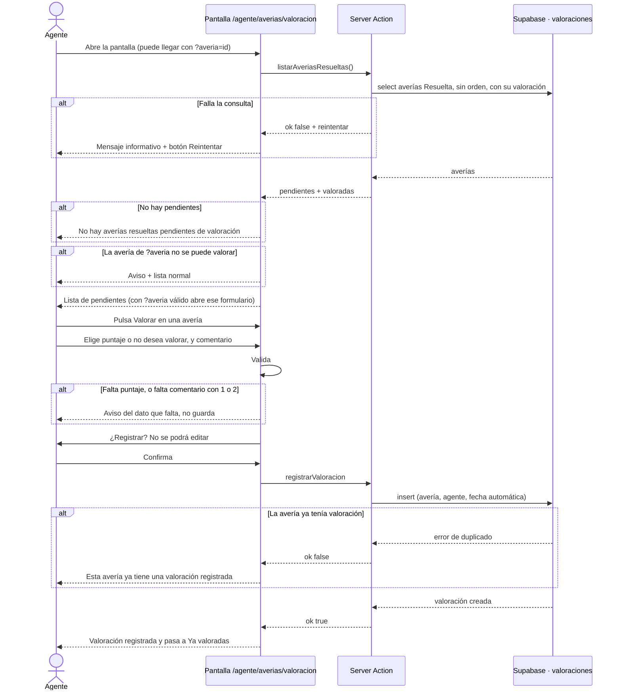

# HU05. Registrar valoración del cliente · Estructura lógica (JOJO-68)

## Objetivo y alcance

HU05 permite al agente del call center registrar la valoración que da el cliente sobre la atención recibida, para medir la calidad del servicio.

- **Historia:** como agente del call center, quiero registrar la valoración que da el cliente sobre la atención recibida para medir la calidad del servicio.
- **Actor y ruta:** agente de call center (rol agente) · `/agente/averias/valoracion`.
- **Ubicación en Jira:** historia JOJO-12 (1 punto), Sprint 1.
- **Dentro del alcance:** listar las averías resueltas pendientes de valorar, registrar la valoración (puntaje de 1 a 5 o "no desea valorar", con comentario), pedir confirmación antes de guardar y mostrar las valoraciones ya registradas en solo lectura.
- **Fuera del alcance:** editar o borrar una valoración, la calificación del cliente sobre el técnico (HU19) y los reportes de calidad.

## Reglas de negocio

Salen de los 7 criterios de aceptación de la historia JOJO-12 (campo "Criterios de Aceptación" en Jira) y de las restricciones de la tabla `public.valoraciones`.

1. Solo se valoran averías **resueltas en primer contacto**: estado "Resuelta" y sin ninguna orden de técnico.
2. El agente pide la valoración al cliente **antes de cerrar la atención**.
3. No se cierra la atención sin un **puntaje de 1 a 5** o la opción **«El cliente no desea valorar»**. No pueden venir ambos.
4. Si el puntaje es **1 o 2**, el comentario es obligatorio; con 3, 4 o 5 es opcional (máximo 500 caracteres).
5. Solo se permite **una valoración por avería** y no se puede editar ni eliminar.
6. Queda asociada a la **avería y al agente**, con fecha y hora automáticas.
7. Antes de guardar se **pide confirmación**.

## Flujo general

## Criterios de aceptación y capa que los cumple

Criterios tal como están en Jira (JOJO-12).

| # | Criterio de Jira | Backend (JOJO-71) | Frontend (JOJO-72) |
|---|---|---|---|
| 1 | Solo se habilita para averías en estado «Resuelta en primer contacto» | Lista y valida solo averías "Resuelta" sin órdenes | Tabla solo con esas averías |
| 2 | El agente solicita la valoración al cliente antes de cerrar la atención | Valida y guarda la valoración; solo acepta averías de primer contacto | Pantalla con el formulario; al terminar la guía se entra con `?averia=<id>` y esa avería queda abierta |
| 3 | No se cierra sin puntaje de 1 a 5 o «El cliente no desea valorar» | Valida puntaje entero de 1 a 5 o `noDesea: true` | Cinco botones y casilla «El cliente no desea valorar» |
| 4 | Con 1 o 2 el comentario es obligatorio; en las demás es opcional | Rechaza si falta el comentario con 1 o 2 | Marca el campo obligatorio y avisa |
| 5 | Una valoración por avería; no se edita ni elimina | `unique (averia_id)`, error `23505`, solo `insert` | Sin botones de editar ni borrar |
| 6 | Asociada a la avería y al agente, con fecha y hora automáticas | Guarda `averia_id` y `agente_id`; `fecha` automática | Muestra la fecha en "Ya valoradas" |
| 7 | Pide confirmación antes de guardar | Nada adicional | Paso "¿Registrar? No se podrá editar" |

Si falla la carga de averías, el backend devuelve `ok: false` y `reintentar: true`, y el frontend muestra el mensaje con el botón Reintentar.

## Datos y seguridad

HU05 escribe en `public.valoraciones` y lee `averias`, `clientes` y `tipos_averia`. Las tablas ya existen; no se modifican.

| Campo en `valoraciones` | Uso |
|---|---|
| `averia_id` | La avería valorada (única) |
| `puntaje` | 1 a 5, o vacío si no desea valorar |
| `no_desea` | `true` si el cliente no quiso valorar |
| `comentario` | Texto opcional; obligatorio con puntaje 1 o 2 |
| `agente_id` | Agente que la registró |
| `fecha` | Fecha y hora del registro (automática) |

- **Acceso:** solo el rol agente. Sin sesión redirige a `/login`; con otro rol, a su menú.
- **Base de datos (RLS):** `valoraciones_insertar` solo permite insertar al agente; `valoraciones_ver` deja leer al personal. No existen políticas de edición ni de borrado.
- **Restricciones en la tabla:** `unique (averia_id)`, y dos `check` que repiten las reglas 3 y 4.

## Contrato del backend

Archivo: `src/app/agente/averias/valoracion/actions.js`. Todas devuelven `{ ok: true, ... }` o `{ ok: false, error: "mensaje" }`.

| Función | Entrada | Respuesta |
|---|---|---|
| `listarAveriasResueltas()` | Ninguna | `{ ok: true, pendientes: [...], valoradas: [...] }` |
| `registrarValoracion(datos)` | `{ averiaId, puntaje, noDesea, comentario }` | `{ ok: true, codigo, valoracion }` |
| Falla la consulta de la lista | — | `{ ok: false, error: "No se pudo cargar las averías resueltas. Intenta nuevamente.", reintentar: true }` |

Cada elemento de `pendientes` y `valoradas` trae `id`, `codigo`, `descripcion`, `fecha_resolucion`, `tipo.nombre` y `cliente` (`codigo`, `nombre_completo`, `documento`, `telefono`). Las `valoradas` incluyen además `valoracion` con `puntaje`, `no_desea`, `comentario` y `fecha`.

Errores de `registrarValoracion` (mensajes en español para mostrar tal cual):

- Sin puntaje y sin "no desea valorar".
- Puntaje 1 o 2 sin comentario.
- Comentario de más de 500 caracteres.
- La avería no existe, no está "Resuelta" o tuvo una orden de técnico (no es de primer contacto).
- La avería ya tiene valoración.

## Prototipo de la pantalla (JOJO-69)

| Zona | Contenido |
|---|---|
| Encabezado | Título «Valoración del cliente» y una línea que explica la pantalla |
| Pendientes de valoración | Tabla con Avería, Cliente, Tipo, Descripción, Resuelta y el botón **Valorar** |
| Formulario (aparece al pulsar Valorar) | Cinco botones de puntaje (1 Muy mala, 2 Mala, 3 Regular, 4 Buena, 5 Excelente); casilla «El cliente no desea valorar»; comentario (obligatorio con puntaje 1 o 2, máximo 500 caracteres); botones **Registrar valoración** y **Cancelar** |
| Confirmación | Mensaje «¿Registrar? No se podrá editar» con los botones **Sí, registrar** y **Volver** |
| Ya valoradas | Tabla de solo lectura con Avería, Cliente, Valoración, Comentario y Registrada (últimas 20) |

## Casos de prueba

Los ejecuta JOJO-73 (Josep) con `agente@demo.com`. Antes hay que haber corrido `05_datos_flujo.sql` y `06_hu05_valoraciones.sql` en Supabase (dan 6 averías "Resuelta" de prueba).

| Caso | Criterio | Pasos | Resultado esperado |
|---|---|---|---|
| CP-01 | 1 | Abrir `/agente/averias/valoracion` | Se ven las averías Resuelta sin orden y sin valoración; no aparecen las Reportada, En diagnóstico, No resuelta ni las Resuelta que tuvieron orden de técnico |
| CP-02 | 3, 6, 7 | Valorar una avería con 5 y sin comentario; confirmar | Aviso de éxito y la avería pasa a "Ya valoradas" con 5 · Excelente |
| CP-03 | 4 | Elegir puntaje 1 y pulsar Registrar sin comentario | Aviso "Si el puntaje es 1 o 2, escribe un comentario." y no guarda |
| CP-04 | 4 | Repetir con puntaje 2 y un comentario | Se guarda con el comentario |
| CP-05 | 3 | Marcar "El cliente no desea valorar" y registrar | Se guarda sin puntaje y se muestra "No desea valorar" |
| CP-06 | 3 | Marcar "no desea valorar" y comprobar los botones de puntaje | Los puntajes quedan desactivados |
| CP-07 | 5 | Abrir la pantalla en dos pestañas, valorar la misma avería en ambas | La segunda muestra "Esta avería ya tiene una valoración registrada." |
| CP-08 | 5 | Revisar la tabla "Ya valoradas" | No hay botones para editar ni borrar |
| CP-09 | 7 | Pulsar Registrar y luego Volver | No se guarda nada |
| CP-10 | 4 | Escribir más de 500 caracteres | El campo no deja pasar de 500 |
| CP-11 | Carga | Simular un fallo cambiando temporalmente en tu copia el nombre de la tabla `averias` en la consulta (sin subir ese cambio) | Mensaje informativo y botón Reintentar |
| CP-12 | Acceso | Abrir la ruta con `gerente@demo.com` y sin sesión | Con otro rol redirige a su menú; sin sesión, a `/login` |
| CP-13 | 2 | Abrir `/agente/averias/valoracion?averia=<id de una avería pendiente>` | El formulario de esa avería aparece abierto |
| CP-14 | 1 | Abrir la ruta con `?averia=<id de una avería ya valorada o con orden>` | Aviso amarillo y la lista normal; no se puede valorar |

Para repetir las pruebas hay un bloque comentado al final de `06_hu05_valoraciones.sql` que borra las valoraciones de prueba (solo se ejecuta en el SQL Editor).

## Subtareas y orden

| Subtarea | Tipo · horas | Responsable | Entregable |
|---|---|---|---|
| JOJO-68 Definir estructura lógica | Análisis y diseño · 2 h | Javier Arturo Lopez Marchan | Este documento |
| JOJO-69 Crear interfaces | Prototipado · 2 h | Javier Arturo Lopez Marchan | Prototipo de la sección anterior |
| JOJO-70 Crear base de datos | Codificación · 2 h | Luis Eduardo Cieza Llanos | `supabase/06_hu05_valoraciones.sql` |
| JOJO-71 Programar backend | Codificación · 4 h | Luis Eduardo Cieza Llanos | `valoracion/actions.js` |
| JOJO-72 Programar frontend | Codificación · 3 h | Sneider Araneda | `valoracion/page.js` y `ValoracionAverias.js` |
| JOJO-73 Pruebas y depuración | Test · 2 h | Josep Karei Pereda Flores | Casos de prueba ejecutados |
| JOJO-74 Desplegar en la web | Configuración · 1 h | Josep Karei Pereda Flores | HU05 publicada en Vercel |

Orden: estructura lógica y prototipo → base de datos → backend → frontend → pruebas → despliegue.

## Archivos de HU05

Todos son nuevos.

- `src/app/agente/averias/valoracion/actions.js`
- `src/app/agente/averias/valoracion/page.js`
- `src/app/agente/averias/valoracion/ValoracionAverias.js`
- `supabase/06_hu05_valoraciones.sql`

## Decisiones tomadas

- **«Resuelta en primer contacto»:** el esquema no tiene ese estado. Se define como avería en estado "Resuelta" sin ninguna orden de técnico, igual que en los datos de prueba del equipo (`05_datos_flujo.sql`). Lo aplican la lista y el registro.
- **Valoración antes de cerrar la atención:** al marcar «Resuelta» en la guía el agente llega a esta pantalla con `?averia=<id>` y la avería queda abierta para valorar.
- **Avería que ya no se puede valorar:** si llega por `?averia=<id>` una avería ya valorada, con orden o inexistente, la pantalla muestra un aviso y la lista normal.
