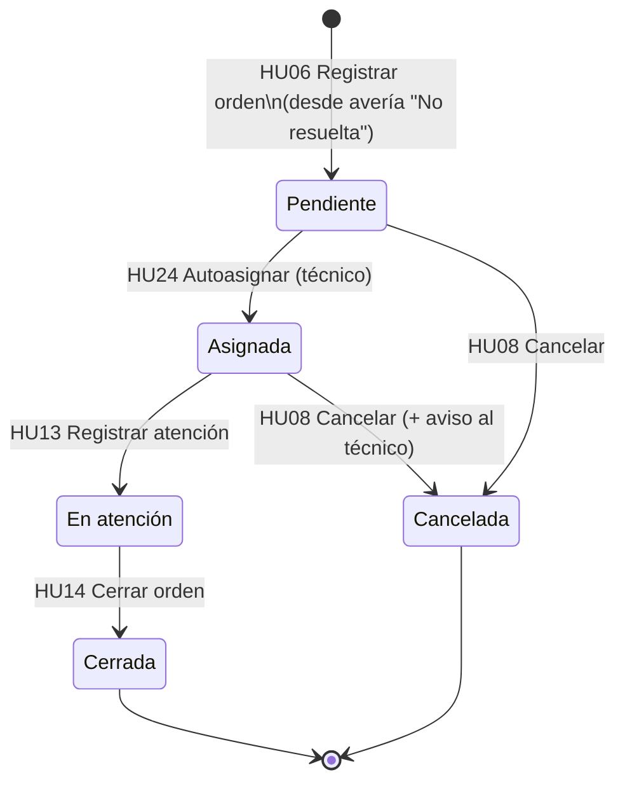
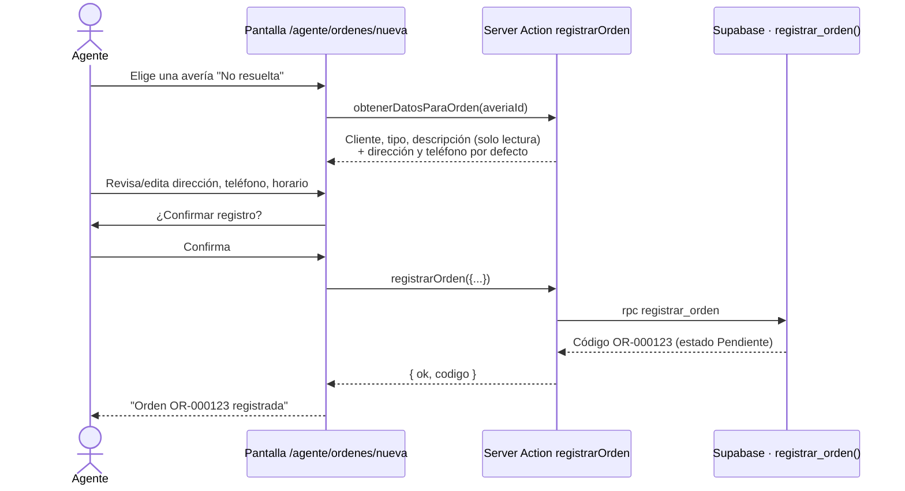
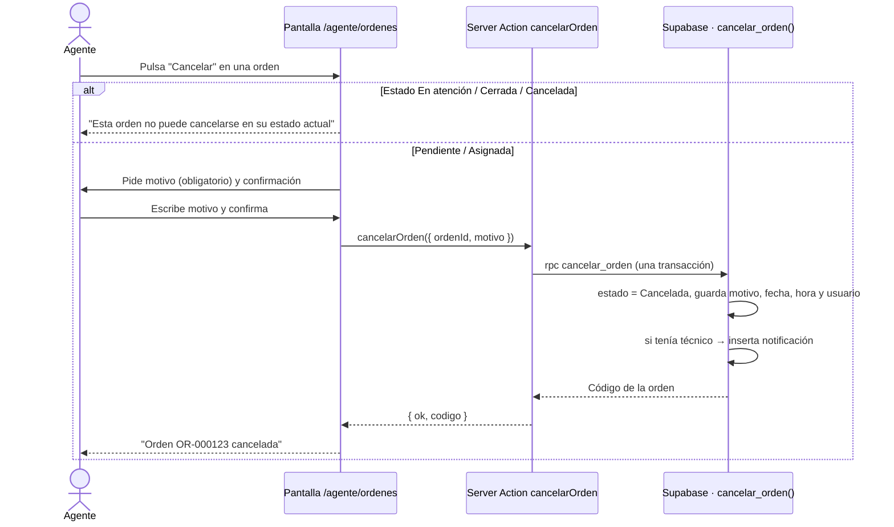

# Estructura lógica · HU06 Registrar orden y HU08 Cancelar orden

Subtareas: **JOJO-59** (HU06) y **JOJO-82** (HU08) · Responsable: Sneider Araneda

## 1. Ciclo de vida de una orden

- **HU07 (modificar)** y **HU08 (cancelar)** solo se permiten en **Pendiente** o **Asignada**.
- Una avería solo puede tener **una orden activa** (Pendiente, Asignada o En atención). Si se cancela, se puede generar otra.

## 2. Flujo HU06 · Registrar orden

## 3. Flujo HU08 · Cancelar orden

Si cualquier paso falla, la transacción se revierte y la orden **conserva su estado anterior** (criterio de HU08).

## 4. Datos que se usan

| Tabla | Campos que intervienen | HU |
|---|---|---|
| `averias` | `id`, `codigo`, `estado` (debe ser "No resuelta"), `descripcion`, `tipo_averia_id`, `cliente_id` | HU06 |
| `clientes` | `direccion`, `telefono` (valores por defecto), `nombre_completo`, `codigo` | HU06 |
| `ordenes` | `codigo` (auto), `averia_id`, `direccion_atencion`, `telefono_contacto`, `horario_preferido`, `estado`, `agente_id`, `fecha_registro` | HU06 |
| `ordenes` | `estado`, `motivo_cancelacion`, `cancelado_por`, `fecha_cancelacion`, `tecnico_id` | HU08 |
| `notificaciones` | `tecnico_id`, `orden_id`, `mensaje` | HU08 |
| `historial_estados` | se llena solo con cada cambio de estado (trigger) | HU06, HU08 |

## 5. Componentes del código

| Capa | Archivo | Qué hace |
|---|---|---|
| Base de datos | `supabase/04_funciones_ordenes.sql` | `registrar_orden()` y `cancelar_orden()` con todas las validaciones; permiso del técnico ajustado |
| Backend | `src/app/agente/ordenes/actions.js` | Server Actions `obtenerDatosParaOrden`, `registrarOrden`, `cancelarOrden` |
| Consultas | `src/app/agente/ordenes/datos.js` | Listas de órdenes y de averías sin orden |
| Pantallas | `src/app/agente/ordenes/page.js` | Listado de órdenes + averías pendientes de orden + cancelar |
| | `src/app/agente/ordenes/nueva/page.js` | Formulario de registro de orden (HU06) |
| | `src/app/agente/ordenes/CancelarOrden.js` | Ventana de cancelación con motivo y confirmación (HU08) |
